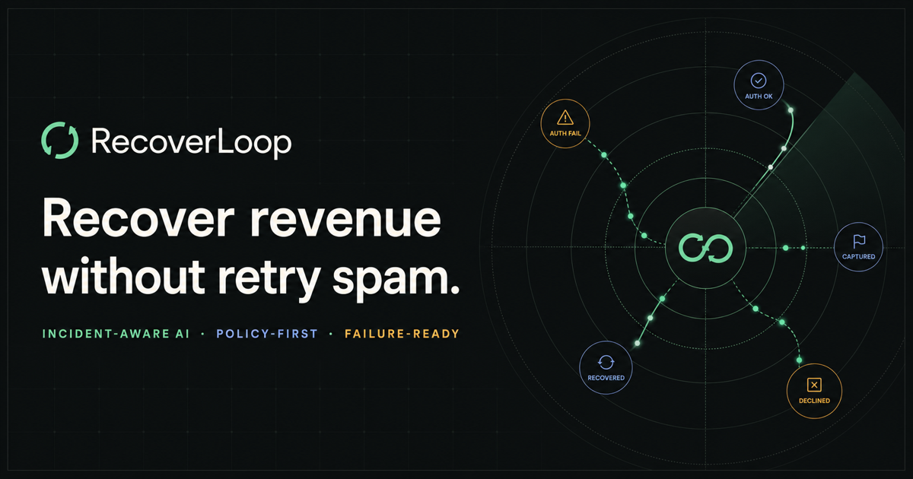
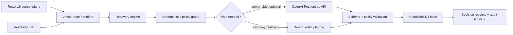

# RecoverLoop

> Recover revenue without retry spam.



RecoverLoop is an incident-aware revenue recovery control plane for failed payment flows. It correlates payment failures with provider health, applies hard safety policy, proposes the next best action, and keeps a decision receipt for every case.

**Track 3 · AI Revenue Recovery**

> [!IMPORTANT]
> RecoverLoop is a submission-ready simulation. Every customer, payment, incident, metric, and recovery outcome in this repository is synthetic. The demo does not connect to Razorpay, charge customers, or send messages.

## Why this problem matters

Payment recovery is often reduced to “retry again” or “send another reminder.” That breaks down when:

- the payment rail is having an incident;
- a success arrives after an earlier failure;
- a webhook is delivered more than once;
- the customer must authenticate or update an expired instrument;
- a risk decision requires automation to abstain;
- an AI or messaging provider is unavailable.

RecoverLoop optimises for **incremental recovered revenue with fewer unnecessary contacts**, not retry volume.

## What the demo proves

- Incident-aware suppression avoids contacting customers for provider-side failures.
- Duplicate events are idempotent and do not create duplicate actions.
- A later success supersedes stale recovery work.
- The callable AI planner persists only policy-revalidated, versioned plans.
- Deterministic fallback keeps the control plane usable when AI is unavailable.
- Risk blocks, consent, contact caps, and human approval are hard constraints.
- Every decision exposes its signals, rejected alternatives, source, and timeline.

The **Reliability Lab** makes the failure paths visible: duplicate webhook, out-of-order success, AI outage, provider timeout, and incident resolution. Reset restores the deterministic seed state. The wider operator surface includes the Command Center, Recovery Queue, Decision Receipt, Incident Center, Policy Replay, and hash-linked Action Receipts.

## Quick start

Prerequisite: Node.js `>=22.13.0`.

```bash
npm ci
npm run dev
```

Open the local URL printed in the terminal. No account, database setup, payment credentials, or AI key is required for the deterministic demo.

### Optional OpenAI planner adapter

The interactive demo works without a key and stays deterministic. Its **Re-plan with guardrails** control calls the server-side Responses API adapter, re-runs policy against the latest case version, and persists the accepted decision with a new approval scope. To exercise the live model path, copy `.env.example` to `.env.local` and add an API key:

```bash
cp .env.example .env.local
```

Without a key—or when the model times out or returns an invalid plan—the same control persists a deterministic fallback. See [AI judgment](docs/AI-JUDGMENT.md).

## Quality checks

```bash
npm run check
```

`npm run check` runs linting, TypeScript validation, domain/AI tests, API/D1/security integration tests, a production build, and rendered-output tests. Granular commands are available as `npm run lint`, `npm run typecheck`, `npm run test:unit`, `npm run test:api`, `npm run build`, and `npm run test:render`.

## Architecture



The application runs as a Vinext application on a Cloudflare Worker-compatible runtime, with React 19 and TypeScript at the UI boundary and project-local D1 emulation during development. The checked-in experience stays deterministic without external services.

Read the [architecture](docs/ARCHITECTURE.md) for component boundaries and event sequencing.

## AI in the right place

AI may rank allowed recovery strategies, explain a recommendation, and draft respectful customer copy. It may not:

- decide whether an event is authentic or new;
- override an active incident, risk block, consent rule, or contact cap;
- charge, refund, reroute, or contact a customer;
- invent a payment state;
- turn an unknown provider result into a retry.

Those are deterministic system responsibilities. The model is advisory and its output is constrained, validated, and replaceable.

## Repository map

```text
app/                 product UI and server routes
db/                  Drizzle schema and D1 access
lib/                 domain contracts, seed data, and recovery logic
worker/              Cloudflare Worker entry point
tests/               automated verification
docs/                architecture, security, operations, and submission pack
```

The server surface is intentionally small:

- `GET /api/state` returns the current dashboard state;
- `POST /api/actions` applies an allow-listed operator or Reliability Lab action with the explicit `X-RecoverLoop-Action: demo` intent header;
- `POST /api/plan` generates, revalidates, versions, and persists an AI or fallback plan;
- `POST /api/webhooks/razorpay` accepts a signed Razorpay-shaped event when a webhook secret is configured.

The machine-readable contract is available in [openapi.yaml](openapi.yaml).

## Submission pack

- [Architecture](docs/ARCHITECTURE.md)
- [AI judgment and boundaries](docs/AI-JUDGMENT.md)
- [Failure recovery and incident drill](docs/FAILURE-RECOVERY.md)
- [Security](docs/SECURITY.md)
- [Operations](docs/OPERATIONS.md)
- [Exact five-minute demo script](docs/DEMO-SCRIPT.md)
- [Copy-ready submission answers](docs/SUBMISSION.md)

## Payment-system references

The reliability design follows the failure modes called out in Razorpay's official documentation: webhook signatures must be verified against the raw body; duplicate delivery is expected; and delivery order is not guaranteed. RecoverLoop demonstrates those semantics with synthetic events rather than claiming a live Razorpay integration.

- [Razorpay: validate and test webhooks](https://razorpay.com/docs/webhooks/validate-test/)
- [Razorpay: Standard Checkout integration and server-side signature verification](https://razorpay.com/docs/payments/payment-gateway/web-integration/standard/integration-steps/)
- [OpenAI: Responses API guide](https://developers.openai.com/api/docs/guides/migrate-to-responses)
- [OpenAI: Structured Outputs](https://developers.openai.com/api/docs/guides/structured-outputs)
- [OpenAI: GPT-5.4 mini model](https://developers.openai.com/api/docs/models/gpt-5.4-mini)

## Scope

RecoverLoop is a rigorous product prototype, not a production payment processor. Before a live rollout, add authenticated multi-tenant access, tenant-specific webhook-secret rotation, complete provider payload mapping and reconciliation, approved messaging integrations, observability, retention controls, and compliance review. The production gate is detailed in [Security](docs/SECURITY.md).
