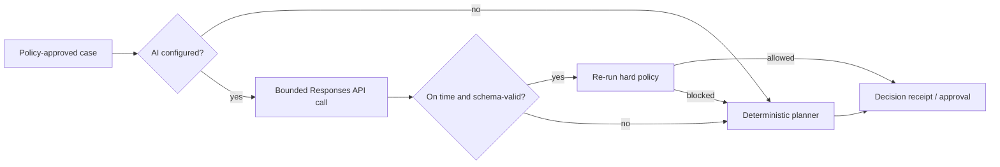

# AI judgment and boundaries

RecoverLoop uses AI for judgment under constraints, not for authority.

The hard part of revenue recovery is selecting a respectful, context-aware next step after deterministic safety checks have reduced the action space. That is where a model can add value. Event authenticity, state transitions, risk controls, consent, contact caps, and financial execution remain ordinary code.

All examples and evaluation numbers in the application are simulated.

## Decision ownership

| Decision | Owner | Why |
| --- | --- | --- |
| Webhook signature and duplicate detection | Deterministic system | Cryptographic and exact |
| Canonical payment state | Deterministic state machine | Must tolerate reordering and replay |
| Active-incident suppression | Deterministic policy | Safety rule, not a prediction |
| Risk-block abstention | Deterministic policy | Must not be overridden |
| Consent, quiet hours, and contact cap | Deterministic policy | Compliance and customer-trust boundary |
| Candidate action ranking | AI or deterministic fallback | Benefits from context across signals |
| Plain-language rationale | AI or deterministic fallback | Useful for operator review |
| Respectful message draft | AI or deterministic fallback | Language task within an allowed intent |
| Approval | Human operator | Explicit accountability for consequential actions |
| Charge, refund, reroute, or send | External authorised system | Outside the model and outside this demo |

## Planner contract

The planner receives a minimised, structured case: failure class, rail, amount band, tenure, locale, contact history, incident state, and the actions that policy has already allowed. Provider payloads and customer-authored text are treated as untrusted data, never as instructions.

The planner may return only:

- one action from the supplied allow-list;
- a bounded confidence value;
- a concise operator explanation;
- a message draft when outreach is allowed;
- rejected alternatives with reasons.

The adapter validates the shape and is designed for the caller to re-run current policy after planning. Unknown fields, an action outside the allow-list, prohibited outreach, or an expired decision must cause rejection and deterministic fallback.

## Hard policy gates

1. **Success wins.** A captured or otherwise confirmed success cancels stale recovery activity.
2. **Incident awareness.** A correlated rail or issuer outage suppresses customer outreach and immediate retries.
3. **Risk means abstain.** RecoverLoop never routes around a provider risk decision.
4. **Customer permission matters.** No contact is proposed without consent.
5. **Fatigue is bounded.** Contact caps and quiet hours cannot be relaxed by the model.
6. **Authentication is interactive.** A backend retry is not proposed when customer authentication is required.
7. **Unknown is not failed.** A provider timeout requires reconciliation before another dispatch.
8. **Approval is scoped.** Approval applies to one version of one action; changed inputs require re-evaluation.

## When AI is deliberately not used

- duplicate webhook handling;
- out-of-order event resolution;
- incident gating;
- amount arithmetic and metric aggregation;
- idempotency keys;
- risk-control enforcement;
- permission and contact-limit checks;
- actual payment or communication execution.

These jobs are clearer, faster, cheaper, and more reliable as deterministic logic.

## Degradation path

An AI outage lowers planner capability; it does not remove the control plane. The Reliability Lab demonstrates this transition deterministically, while the adapter tests cover live-call failure classes. The UI identifies the recorded planner source so an operator can distinguish AI, policy, and fallback decisions.

## Model configuration

The optional, tested adapter targets the OpenAI Responses API with `gpt-5.4-mini` by default. **Re-plan with guardrails** invokes it server-side, rechecks the current decision version and policy, and persists only an accepted result. Missing keys and provider failures persist deterministic fallback. The model name is configuration, not embedded business logic; the API key remains server-side and out of source control.

- [OpenAI Responses API guide](https://developers.openai.com/api/docs/guides/migrate-to-responses)
- [OpenAI Structured Outputs guide](https://developers.openai.com/api/docs/guides/structured-outputs)
- [OpenAI GPT-5.4 mini model reference](https://developers.openai.com/api/docs/models/gpt-5.4-mini)

## Evaluation

The dashboard comparison is an illustrative synthetic scenario, not a measured production uplift or model benchmark. A real evaluation should replay time-ordered, de-identified historical events and compare against a fixed policy baseline on:

- incremental recovered amount, not raw retry success;
- customer contacts per recovered payment;
- false outreach during provider incidents;
- duplicate action rate;
- stale action rate after late success;
- policy violation rate;
- abstention and human override rate;
- latency, token cost, and fallback rate.

A safe launch would begin in shadow mode, then recommendation-only mode, and only later permit narrowly scoped, approved automation.
