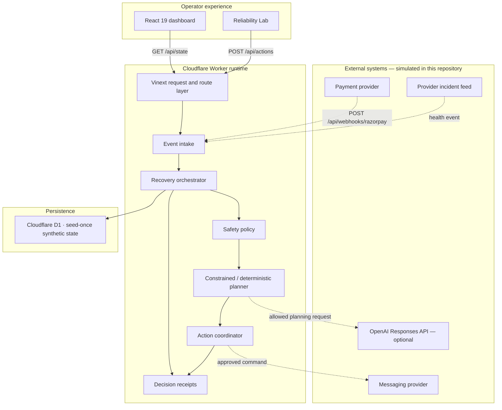
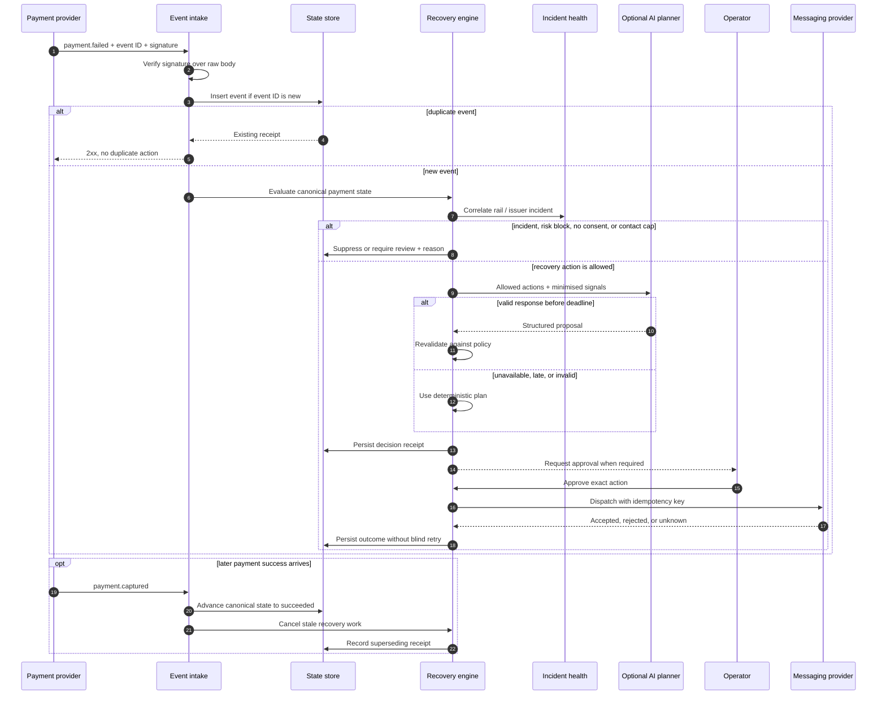

# Architecture

RecoverLoop is an incident-aware decision and operations layer around payment recovery. It does not replace a payment gateway and it does not execute financial transactions in this demo.

All records and outcomes shown by the application are simulated.

## Design goals

1. Prefer a correct non-action over a harmful retry.
2. Treat payment events as duplicated, delayed, and potentially out of order.
3. Keep policy deterministic and AI replaceable.
4. Make every action explainable and auditable.
5. Run locally with no credentials or external dependencies.

## System context

Solid lines represent the implemented product loop. Dashed integrations are production-facing seams; the checked-in demo simulates them and does not send network requests to a payment or messaging provider.

## Request boundaries

| Boundary | Responsibility | Failure posture |
| --- | --- | --- |
| UI | Render state, collect explicit operator intent | Never infers success from optimistic UI |
| Route/API layer | Serve `GET /api/state`, `POST /api/actions`, and `POST /api/webhooks/razorpay` | Require explicit demo intent; reject unknown actions, malformed IDs, oversized bodies, and invalid signatures |
| Recovery engine | Apply transitions and recompute metrics | Preserve terminal success; make repeated events idempotent |
| Policy | Enforce incident, risk, consent, fatigue, and approval rules | Deny or abstain when a safe action is not available |
| Planner adapter | Rank only policy-allowed actions and explain the choice | Tested deterministic fallback on missing key, timeout, or invalid output |
| Action coordinator | Record a simulated action result | Unknown outcome is not equivalent to failure and is not blindly repeated |
| Persistence | Store state and audit records | Fail closed for outward actions if durable state is unavailable |

## Recovery sequence

The production sequence below is the design target. The Reliability Lab injects equivalent synthetic transitions through the application's demo API.

## State and invariants

The case state is deliberately small: observing, pending approval, scheduled, recovered, suppressed, or manual review. Transitions observe these invariants:

- `recovered` supersedes a prior failure and stops pending recovery work.
- Replaying the same event or command does not repeat its business effect.
- A provider timeout yields an unknown outcome, not permission to issue a second command.
- An active provider incident suppresses customer-blaming outreach.
- A risk block cannot be bypassed through an alternate rail.
- AI output must pass the same policy checks as deterministic output.
- High-impact actions require explicit operator approval.
- Money is represented in integer minor units; display formatting is a UI concern.

## Data shape

A recovery case joins the minimum context needed to make a safe decision:

- payment amount, currency, rail, and normalised failure class;
- pseudonymous customer reference, tenure, segment, locale, and consent;
- contact count, case status, owner, and expected value;
- recommendation, explanation, rejected actions, signals, and timeline;
- planner source (`policy`, `ai`, or `fallback`) and confidence.

The demo seed contains synthetic personas for storytelling. A production planner should receive pseudonymous references and derived features, not raw card data, authentication data, email addresses, or phone numbers.

### Persistence layout

| D1 table | Stored purpose |
| --- | --- |
| `dashboard_state` | Seed-once dashboard state, optimistic revision, state hash, and current audit-chain head |
| `provider_events` | Unique provider event ID, allow-listed event type, payload hash, correlation ID, and chained integrity metadata |
| `audit_records` | Demo action receipt with before/after hashes, correlation ID, and chained integrity metadata |

Schema bootstrap is idempotent at runtime. Mutations use bound D1 statements and optimistic revision checks, so concurrent updates are retried within a small fixed bound. The webhook route stores a SHA-256 payload hash rather than the raw provider payload. Hash links make missing or modified application records detectable during verification; they do not make D1 immutable or provide independent attestation.

## Why this stack

- **Vinext + React 19**: one TypeScript application with server-rendered product UI and route handlers.
- **Cloudflare Worker runtime**: an edge-compatible execution model suitable for fast intake and operator reads.
- **Cloudflare D1 + Drizzle**: SQL persistence with typed schema access and a checked-in deployment migration.
- **OpenAI Responses API, optional**: the guarded re-plan control invokes a tested server-side adapter, then current policy revalidates and versions the result before persistence; zero-key mode uses the same deterministic fallback path.
- **Node test runner + ESLint + TypeScript build**: a compact verification path with fewer moving parts.

“Latest” is not the goal by itself. Versions are locked in `package-lock.json`, the runtime floor is declared in `package.json`, and the demo has no required SaaS dependency.

## Scale path

For production, separate intake from planning with a durable queue, partition idempotency by merchant and provider event ID, and use a transactional outbox for approved commands. Keep raw event retention short, store normalised features separately, and reconcile unknown provider outcomes before retrying. Apply tenant scoping at every query and action boundary.
